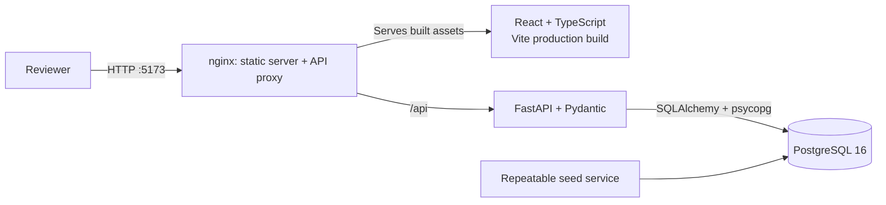
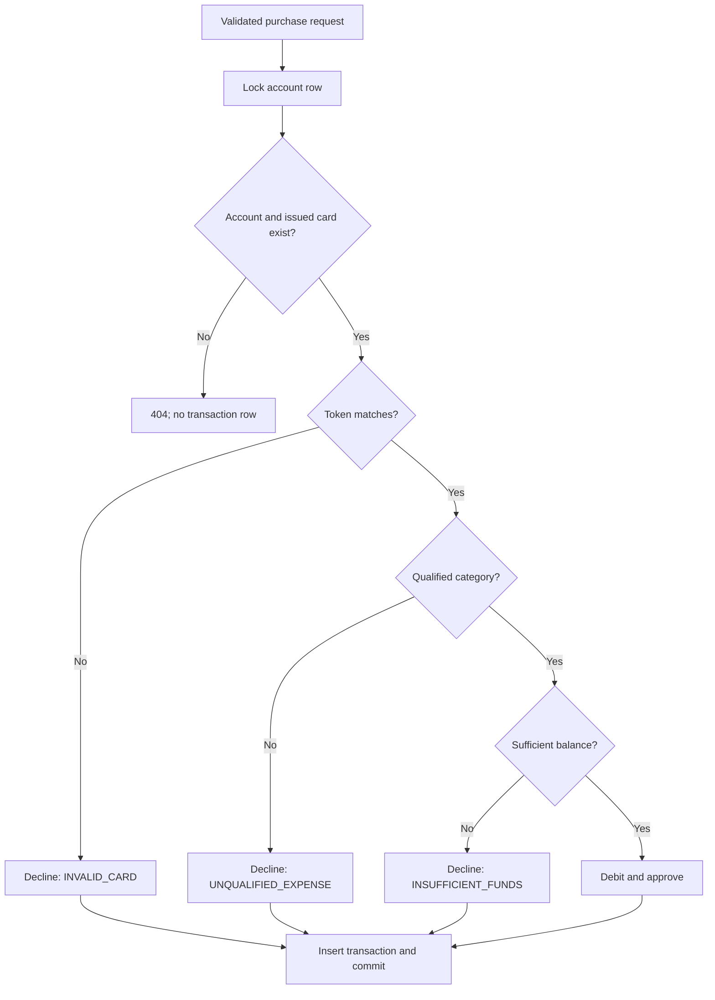

# HSA Account Simulation architecture.md

This document describes the system as implemented. I often find visuals to be  
the fastest way to understand a new system, so the diagrams below demonstrate that.

## System architecture



- The frontend is a React, TypeScript, and Vite single-page application. React
Router owns Home, account-detail, Transactions, and styled not-found views.
- nginx serves the production frontend, falls back to `index.html` for client
routes, and proxies `/api` to the backend container.
- FastAPI validates requests and exposes health, account, deposit, card,
purchase, and account-history endpoints.
- SQLAlchemy Core defines the query layer and psycopg connects it to PostgreSQL.
PostgreSQL is the source of truth for balances, constraints, and concurrency.
- Docker Compose starts PostgreSQL, the seed job, backend, and frontend. Seed
data is enabled by default and can be disabled with `SEED_DATA=false`.

The application uses relative `/api` requests, so the same frontend contract
works through the Vite development proxy and the nginx production proxy.

## Request flow

1. `POST /api/accounts` validates and normalizes the holder name, then creates

   a zero-balance USD account. PostgreSQL allocates its account number.
2. `POST /api/accounts/{id}/deposits` converts a validated dollar string to

   integer cents, increments the balance, and records an approved deposit in
     the same database transaction.
3. `POST /api/accounts/{id}/card` creates one simulated card or returns the

   existing card. Database uniqueness enforces one card per account.
4. `POST /api/accounts/{id}/purchases` evaluates the request and records an

   approved or declined transaction.
5. `GET /api/accounts/{id}/transactions` returns newest-first account activity.

   The global UI combines these per-account responses into aggregate activity.

### Card request flow

```mermaid
sequenceDiagram
    participant UI as Browser UI
    participant API as FastAPI
    participant DB as PostgreSQL
    UI->>API: POST /api/accounts/{id}/card
    API->>DB: Insert card or select existing card
    DB-->>API: token + card metadata
    API-->>UI: 201/200 {token, card_last4, issued_at}
    Note over UI: Keep token in memory; display only card_last4
    UI->>API: POST /api/accounts/{id}/purchases {card_token: token}
```

The simulated token is a unique, randomly generated 16-digit value. The app
does not collect a real PAN or CVV. Account responses expose only the computed
last four digits. The card endpoint returns the token because the simulation
needs purchase credential material; the browser keeps it in memory and never
renders it in a form field.

Card issuance is idempotent: the first request returns `201 Created`, and later
requests return the same card with `200 OK`. This lets the UI recover the token
after navigation without creating a second card.

## Data model

```mermaid
erDiagram
    ACCOUNTS ||--o| CARDS : "has one"
    ACCOUNTS ||--o{ TRANSACTIONS : records
    CARDS o|--o{ TRANSACTIONS : "used by"

    ACCOUNTS {
        UUID id PK
        BIGINT account_number UK
        TEXT holder_name
        CHAR3 currency
        INTEGER balance_cents
        TIMESTAMPTZ created_at
    }

    CARDS {
        UUID id PK
        UUID account_id FK UK
        VARCHAR16 token UK
        TIMESTAMPTZ issued_at
    }

    TRANSACTIONS {
        UUID id PK
        UUID account_id FK
        UUID card_id FK
        TEXT kind
        INTEGER amount_cents
        TEXT merchant
        TEXT category
        TEXT outcome
        TEXT decline_reason
        TIMESTAMPTZ created_at
    }
```

### Accounts

- UUID primary key for internal identity.
- Unique decimal `account_number`, allocated by a sequence beginning at
`1000000000`, for reviewer-facing lookup and navigation.
- Normalized holder name between 1 and 120 characters.
- USD-only currency and a nonnegative balance stored as integer cents.

### Cards

- UUID primary key and unique account foreign key.
- Unique, 16-digit simulated token with a database format constraint.
- One card per account; card lifecycle status is outside the MVP.

### Transactions

- Deposits and purchases share one append-only activity table.
- Positive integer-cent amounts avoid binary floating-point money errors.
- A deposit has no card or category and is always approved.
- A purchase references a card and records its merchant and category.
- An approved row has a null decline reason. A declined row must use
`INVALID_CARD`, `UNQUALIFIED_EXPENSE`, or `INSUFFICIENT_FUNDS`.
- Database checks reinforce these shapes, while indexes support newest-first
account history and card lookup.

## Purchase processing

The backend, not the browser, makes qualification and balance decisions. It
normalizes the category to lowercase and evaluates checks in a fixed order:



The complete UI list is Medical, Dental, Vision, Pharmacy, Travel,
Entertainment, and Other. The qualified subset is Medical, Dental, Vision, and
Pharmacy. Non-qualified or unknown categories are recorded as
`UNQUALIFIED_EXPENSE`.

The account and issued card must exist before a transaction can be recorded.
After that, the token is checked before qualification, and qualification before
funds. Only an approved purchase changes the balance. The balance update and
transaction insert commit together; an error rolls the operation back.

## Concurrency handling

The purchase handler selects the account row with PostgreSQL
`SELECT ... FOR UPDATE`. Concurrent purchases for one account serialize around
the balance decision:

1. The first request locks the account and evaluates the current balance.
2. A second request waits instead of reading the same stale balance.
3. After the first commits, the second evaluates the updated balance.

For a $100 balance, concurrent qualified purchases of $80 and $50 produce one
approval and one `INSUFFICIENT_FUNDS` decline, leaving either $20 or $50. The
important invariant is exactly one approval—not which request wins.

The global simulator starts two normal purchase requests with `Promise.all`; it
does not use a test-only endpoint. Both entries only need to be individually
valid and affordable when entered. They do not need to exceed the current
balance together, which lets reviewers demonstrate contested and non-contested
requests. The backend remains the source of truth for both outcomes.

## Global transaction simulator

Reviewers can open the simulator from Home or Transactions, search loaded
accounts by holder name or account number, and follow an account-number link to
its detail page. An account without a card shows an issue-card instruction
instead of silently creating one. A carded account uses the idempotent card
endpoint to recover its opaque token.

Single mode reuses the standard purchase form. Concurrency mode presents two
purchase forms and the complete seven-category list, starts both requests
together, waits until both settle, and refreshes balances and activity. The
modal keeps a stable, viewport-safe height and scrolls its content internally.

## Design tradeoffs and limitations

- **SQL file instead of migrations:** `backend/schema.sql` is easy to inspect
and initialize, but a production system would add versioned migrations.
- **Single backend route module:** the current API is small enough for one
module. Continued growth would justify separate account, card, and transaction
services.
- **Aggregate activity:** the global UI requests history per account. This is
simple for the assignment dataset; production would expose one paginated
global-history endpoint.
- **Simulation token:** returning a token is acceptable locally. Production
card credentials require a payment processor, encryption or tokenization,
secret management, and stricter authorization.
- **No authentication or account authorization:** the MVP assumes a local
reviewer. Production endpoints would authenticate users and enforce account
ownership.
- **Fixed HSA rules:** the deterministic category map demonstrates the flow; it
is not tax or payment-network advice. Production would use richer merchant
evidence and auditable policy versions.
- **Operational scope:** observability, rate limiting, deployment hardening,
accessibility audits, and broader browser testing remain follow-up work.
